# Proxy and Content Filtering System
## Project 28 — Computer Networks

**Project Type:** TCP Proxy and SDN-Based Content Filtering  
**Protocol:** TCP  
**SDN Controller:** OS-Ken  
**Network Emulator:** Mininet  
**Switch:** Open vSwitch  
**OpenFlow Version:** 1.3

**GitHub Repository:**  
https://github.com/MoolaAdithya/proxy-content-filtering-system

---

# 1. Project Overview

The Proxy and Content Filtering System is a network security project designed to control client access to simulated backend services through a TCP proxy.

The system inspects HTTP requests and evaluates them against configurable filtering policies. Based on the policy decision, requests are allowed, denied, or monitored.

When a client repeatedly violates the configured security policies, the proxy can communicate with an SDN controller through a REST API. The controller dynamically installs OpenFlow rules in the Open vSwitch to block the client's traffic at the network level.

The project combines application-layer request inspection with network-layer enforcement.

## 1.1 Problem Statement

Unrestricted access to backend services can expose systems to unwanted traffic, malicious requests, and unauthorized access.

Traditional request filtering can reject malicious HTTP requests, but repeated violations may continue reaching the application.

This project addresses the problem by implementing:

- TCP proxy-based request inspection.
- Configurable content filtering policies.
- Application-layer access control.
- Dynamic SDN-based IP blocking.
- Destination-port restrictions.
- Traffic logging and monitoring.
- Performance evaluation of proxy overhead.

## 1.2 Objectives

- Develop a concurrent TCP proxy.
- Parse and forward HTTP requests.
- Dynamically allow or block traffic using configurable policies.
- Implement network-level blocking using SDN.
- Integrate the proxy with an OS-Ken controller.
- Implement REST API-based communication.
- Maintain logs of permitted and blocked traffic.
- Collect flow statistics from the Open vSwitch.
- Evaluate proxy overhead and filtering performance.

---

# 2. System Architecture

The system contains three major layers.

### Application Layer

The application layer receives client requests, inspects HTTP messages, evaluates filtering policies, and forwards permitted requests to the backend service.

### Network Layer

The network layer is implemented using Mininet and Open vSwitch. It provides connectivity between the client, proxy, backend, and testing hosts.

### SDN Control Layer

The OS-Ken controller manages the Open vSwitch through OpenFlow 1.3. It dynamically installs and removes flow rules to enforce network-level restrictions.

## 2.1 Architecture Diagram


## 2.2 Network Topology

| Component | IP Address | Role |
|---|---|---|
| h1 | 10.0.0.1 | Normal client |
| h2 | 10.0.0.2 | TCP proxy |
| h3 | 10.0.0.3 | Backend service |
| h4 | 10.0.0.4 | Attacker and testing client |
| s1 | Open vSwitch | Network forwarding |
| Root namespace | 10.0.0.254 | Controller REST API connectivity |

### Network Ports

| Component | Port |
|---|---:|
| Proxy | 8888 |
| Backend HTTP service | 80 |
| Backend test service | 9002 |
| SDN Controller OpenFlow | 6653 |
| Controller REST API | 8080 |
| Dashboard | 5000 |

---

# 3. Project Directory Structure

```text
project28/
│
├── client.py
├── proxy.py
├── service.py
│
├── controller.py
├── topology.py
├── rules.py
├── policy.json
├── lab.py
│
├── test_proxy_http.py
├── test_rules.py
├── run_tests.py
├── bench.py
├── traffic.py
├── run_experiments.py
├── harness.py
├── dashboard.py
│
├── ui/
│   └── index.html
│
├── README.md
├── POLISH_NOTES.md
│
└── docs/
    └── screenshots/
```

---

# 4. Team Contributions and File-Level Implementation

The project is divided into three members based on application-layer development, network and SDN integration, and testing and performance evaluation.

# Prajwal M R — Application Layer Implementation

## Files Completed

| File | Description |
|---|---|
| `proxy.py` | TCP proxy implementation |
| `client.py` | Client request generation |
| `service.py` | Backend service implementation |

## 4.1 `proxy.py` — TCP Proxy

### Purpose

The proxy acts as an intermediary between the client and the backend server.

It receives client requests, performs HTTP parsing and policy evaluation, and forwards permitted requests to the backend.

### Main responsibilities

- Listen for incoming TCP connections on port 8888.
- Accept client connections.
- Handle concurrent client requests.
- Parse HTTP requests.
- Communicate with the policy engine.
- Forward permitted requests to the backend service.
- Reject requests that violate filtering policies.
- Communicate with the SDN controller through the REST API.
- Maintain permitted and blocked traffic logs.
- Measure request-processing overhead.

### Request Processing Flow

```text
Client Request
      |
      v
TCP Connection to Proxy
      |
      v
HTTP Request Parsing
      |
      v
Policy Evaluation
      |
      +------ Allow ------> Backend Server
      |
      +------ Deny -------> Error Response
      |
      +------ Violation --> SDN Block Request
```

### SDN Integration

The proxy can send a blocking request to the controller when the configured strike limit is reached.

The controller receives the request through:

```text
POST /policy/block
```

This integrates application-layer security with network-level enforcement.

## 4.2 `client.py` — Client Implementation

### Purpose

The client generates requests to test the proxy and backend service.

### Main responsibilities

- Establish TCP communication with the proxy.
- Generate HTTP requests.
- Send requests through the proxy.
- Receive responses.
- Display response status and content.
- Test permitted and denied requests.

### Testing Scenarios

- Valid HTTP request.
- Request containing a banned keyword.
- Request to a restricted hostname.
- Request using a denied HTTP method.
- Repeated policy violations.

## 4.3 `service.py` — Backend Service

### Purpose

The backend service simulates a server that provides content to clients through the proxy.

### Main responsibilities

- Listen for incoming connections.
- Provide simulated backend content.
- Respond to valid HTTP requests.
- Support testing of proxy forwarding.
- Provide service endpoints on ports 80 and 9002.

The backend is hosted on h3.

---

# Moola Adithya — Network Layer and SDN Integration

## Files Completed

| File | Description |
|---|---|
| `topology.py` | Mininet network topology |
| `controller.py` | OS-Ken SDN controller |
| `rules.py` | Filtering policy evaluation engine |
| `policy.json` | Configurable security policies |
| `lab.py` | Complete project integration and startup |

## 4.4 `topology.py` — Mininet Topology

### Purpose

Creates the virtual network used by the project.

### Implementation Details

- Creates four virtual hosts.
- Creates one Open vSwitch.
- Connects the hosts to the switch.
- Assigns IP addresses.
- Configures the remote SDN controller.
- Uses OpenFlow 1.3.
- Creates a root namespace node for controller REST API connectivity.
- Supports link delay configuration.
- Provides network cleanup and setup functionality.

### Host Configuration

```text
h1: 10.0.0.1/24
h2: 10.0.0.2/24
h3: 10.0.0.3/24
h4: 10.0.0.4/24
```

### Controller Configuration

```text
Controller IP: 127.0.0.1
Controller Port: 6653
OpenFlow Version: 1.3
```

### Root Namespace

The root namespace is assigned:

```text
10.0.0.254
```

This allows the proxy to communicate with the controller REST API.

## 4.5 `controller.py` — OS-Ken SDN Controller

### Purpose

Implements the control plane of the network.

The controller manages the Open vSwitch and dynamically applies network-level security policies.

### Implementation Details

- Implements an OS-Ken application.
- Supports OpenFlow 1.3.
- Maintains MAC address learning tables.
- Tracks connected switches.
- Implements packet forwarding.
- Installs table-miss rules.
- Dynamically blocks source IP addresses.
- Dynamically blocks destination ports.
- Supports source-specific port blocking.
- Implements IP and port unblocking.
- Maintains block expiration information.
- Provides REST API endpoints.
- Collects flow statistics.
- Maintains policy history.

### MAC Learning

The controller learns the source MAC address and the corresponding switch port.

When the destination MAC address is known, the packet is forwarded to the correct port.

When the destination is unknown, the packet is flooded.

### Dynamic IP Blocking

The controller installs a source-IP matching drop flow.

Example:

```text
Source IP: 10.0.0.1
Priority: 200
Action: Drop
Timeout: 300 seconds
```

### Port Blocking

The controller supports:

- Global destination-port blocking.
- Source-specific destination-port blocking.
- Runtime unblocking.

The configured static destination port is 9002.

### REST API Endpoints

| Endpoint | Method | Purpose |
|---|---|---|
| `/policy/status` | GET | Retrieve controller status |
| `/policy/stats` | GET | Retrieve flow statistics |
| `/policy/block` | POST | Block an IP address |
| `/policy/unblock` | POST | Unblock an IP address |
| `/policy/port_block` | POST | Block a destination port |
| `/policy/port_unblock` | POST | Unblock a destination port |

### OpenFlow Priorities

| Priority | Rule |
|---:|---|
| 0 | Table-miss rule |
| 10 | Learned MAC forwarding |
| 100 | Global port blocking |
| 150 | Source-specific port blocking |
| 200 | IP blocking |

## 4.6 `rules.py` — Filtering Policy Engine

### Purpose

Evaluates HTTP requests against configured security rules.

### Implementation Details

- Converts HTTP requests into structured representations.
- Normalizes HTTP paths.
- Decodes URL-encoded data.
- Extracts request methods, headers, hostnames, and bodies.
- Compiles policy conditions.
- Evaluates enabled rules in order.
- Implements first-match policy evaluation.
- Supports allow, deny, and monitor actions.
- Uses a default policy action when no rule matches.

### Policy Actions

| Action | Description |
|---|---|
| Allow | Permits the request |
| Deny | Rejects the request |
| Monitor | Records or observes the request without necessarily denying it |

### Request Normalization

The policy engine decodes URL-encoded input and normalizes paths to improve consistency during filtering.

Example:

```text
/a/b/../c
```

Normalized path:

```text
/a/c
```

This helps identify suspicious path traversal patterns.

## 4.7 `policy.json` — Configurable Security Policies

### Purpose

Stores the security policies used by the filtering engine.

### Configuration

The policy file contains:

- Version information.
- Default action.
- Block duration.
- Strike limit.
- Strike window.
- Ordered filtering rules.

### Implemented Rules

| Rule | Function |
|---|---|
| R01 | Health-check access |
| R02 | HTTP method restrictions |
| R03 | SQL injection pattern detection |
| R04 | Path traversal and system-file access detection |
| R05 | XSS pattern detection |
| R06 | Hacking-tool User-Agent detection |
| R07 | Admin access restriction |
| R08 | Executable download restriction |
| R09 | Malware keyword detection |
| R10 | Hostname blocking |
| R11 | Banned URL keyword filtering |
| R12 | Destination-port restrictions |
| R13 | Card-number pattern detection in POST bodies |
| R14 | Upload size restriction |
| R15 | Login request monitoring |
| R16 | Excessive request-rate detection; disabled in the current configuration |

### Strike Configuration

```json
{
  "block_client_on_violation": true,
  "block_duration": 300,
  "strike_limit": 3,
  "strike_window": 60
}
```

This allows repeated policy violations to trigger temporary client IP blocking.

## 4.8 `lab.py` — Project Integration

### Purpose

Coordinates the startup and execution of the complete project.

### Implementation Details

- Builds the Mininet topology.
- Starts the virtual network.
- Waits for the controller connection.
- Performs connectivity checks.
- Starts the backend service.
- Starts the proxy.
- Configures SDN integration.
- Warms up MAC learning.
- Starts the dashboard.
- Provides the Mininet CLI.
- Cleans up processes and network resources.

### Integration Flow

```text
Start Controller
      |
      v
Start lab.py
      |
      v
Build Mininet Topology
      |
      v
Start Backend Service
      |
      v
Start TCP Proxy
      |
      v
Verify Network
      |
      v
Run Demonstration
```

---

# Nishanth U — Testing, Performance Evaluation, and Dashboard

## Files Completed

| File | Description |
|---|---|
| `test_proxy_http.py` | HTTP proxy tests |
| `test_rules.py` | Policy engine unit tests |
| `run_tests.py` | Test execution |
| `bench.py` | Performance benchmarking |
| `traffic.py` | Traffic generation |
| `run_experiments.py` | Performance and attack experiments |
| `harness.py` | Test scenario coordination |
| `dashboard.py` | Monitoring dashboard backend |
| `ui/index.html` | Dashboard frontend |
| `README.md` | Project documentation |
| `POLISH_NOTES.md` | Documentation and final polishing notes |

## 4.9 `test_proxy_http.py` — HTTP Proxy Testing

### Purpose

Tests the HTTP functionality of the proxy.

### Testing Areas

- Request forwarding.
- HTTP response handling.
- Permitted request behavior.
- Denied request behavior.
- Proxy communication with the backend.

## 4.10 `test_rules.py` — Policy Engine Testing

### Purpose

Tests the correctness of the filtering rules.

### Testing Areas

- HTTP method restrictions.
- URL filtering.
- Hostname filtering.
- SQL injection detection.
- Path traversal detection.
- XSS detection.
- Request body filtering.
- Policy action correctness.

The current test suite contains 36 policy-engine unit tests.

## 4.11 `run_tests.py` — Test Execution

### Purpose

Provides a centralized way to execute the project's automated test suite.

It helps verify the functionality of the proxy and policy engine.

## 4.12 `bench.py` — Performance Benchmarking

### Purpose

Generates workloads and measures the performance of the system.

### Evaluation Areas

- Request processing time.
- Proxy overhead.
- Response time.
- System behavior under workload.

## 4.13 `traffic.py` — Traffic Generation

### Purpose

Generates simulated traffic from the Mininet hosts.

### Use Cases

- Normal client traffic.
- Repeated requests.
- Suspicious traffic.
- Attack-like test scenarios.

## 4.14 `run_experiments.py` — Performance Experiments

### Purpose

Runs performance and attack experiments.

### Evaluation Areas

- Proxy overhead.
- Traffic filtering behavior.
- Flood scenario testing.
- System response under different workloads.

The project supports quick experiments through:

```bash
python3 run_experiments.py --quick
```

## 4.15 `harness.py` — Experiment Coordination

### Purpose

Coordinates test scenarios and experiment execution.

It helps organize the testing process and supports repeatable evaluations.

## 4.16 `dashboard.py` — Dashboard Backend

### Purpose

Provides the backend for the monitoring dashboard.

### Features

- Traffic monitoring.
- Policy decision visibility.
- Controller status.
- Blocking information.
- Statistics display.

## 4.17 `ui/index.html` — Dashboard Frontend

### Purpose

Provides the browser interface for the project dashboard.

It presents information about the system in a user-friendly interface.

---

# 5. Complete Request Processing Flow

```text
Client h1 / h4
      |
      v
Open vSwitch s1
      |
      v
Proxy h2 :8888
      |
      v
HTTP Request Parsing
      |
      v
rules.py
      |
      v
policy.json
      |
      +---------- Allow ----------> Backend h3 :80
      |
      +---------- Deny -----------> HTTP Error Response
      |
      +---------- Monitor --------> Logging
      |
      +---------- Strike Limit ---> REST API
                                       |
                                       v
                                OS-Ken Controller
                                       |
                                       v
                                OpenFlow Rule
                                       |
                                       v
                                Open vSwitch
                                       |
                                       v
                                  Drop Traffic
```

---

# 6. Execution Instructions

## 6.1 Start the SDN Controller

```bash
osken-manager controller.py
```

## 6.2 Start the Mininet Lab

```bash
sudo mn -c
sudo python3 lab.py
```

## 6.3 Verify Connectivity

Inside the Mininet CLI:

```bash
pingall
```

## 6.4 Verify Controller Status

```bash
curl http://10.0.0.254:8080/policy/status
```

## 6.5 Verify Controller Statistics

```bash
curl http://10.0.0.254:8080/policy/stats
```

## 6.6 Run Automated Tests

```bash
python3 run_tests.py
```

## 6.7 Run Performance Experiments

```bash
python3 run_experiments.py --quick
```

---


# 7. Project Screenshots

## 7.1 Project Files

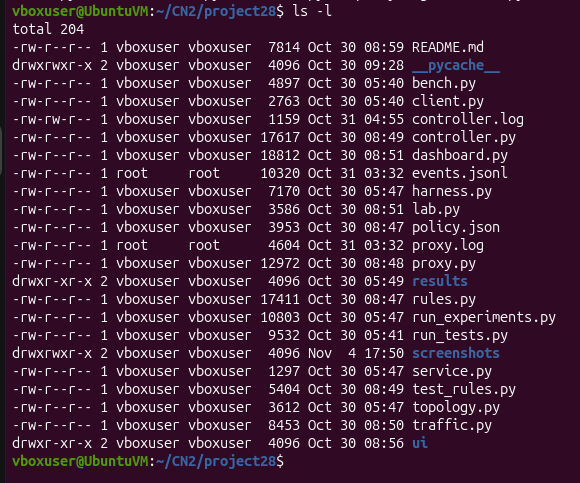

## 7.2 Mininet Topology

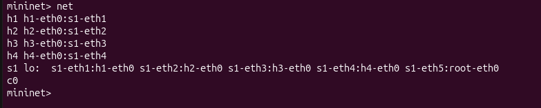

## 7.3 Network Connectivity

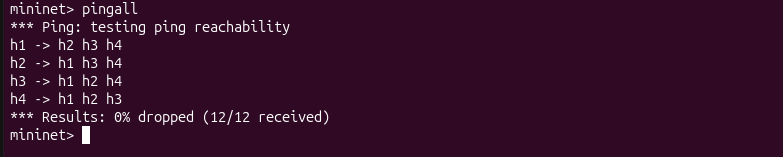

## 7.4 Proxy Startup

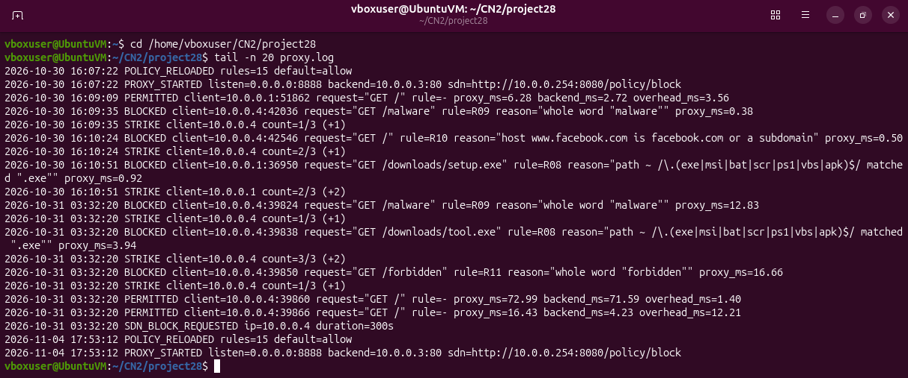

## 7.5 Successful HTTP Request

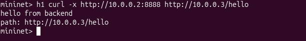

## 7.6 Content Filtering

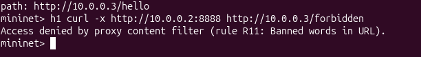

## 7.7 Dynamic SDN Blocking

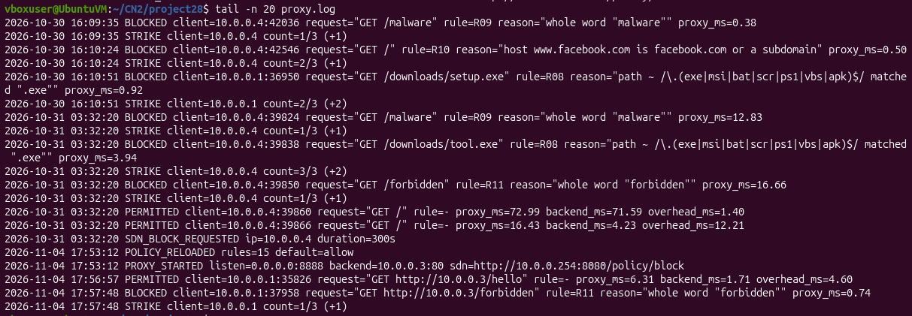

## 7.8 OpenFlow Drop Rules

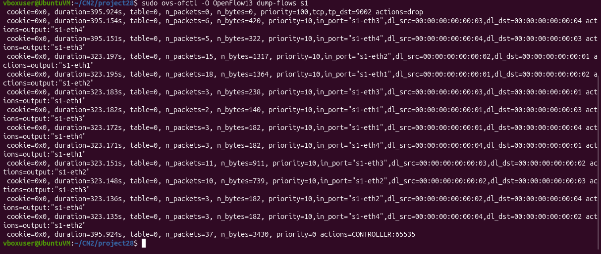

## 7.9 Blocked Client

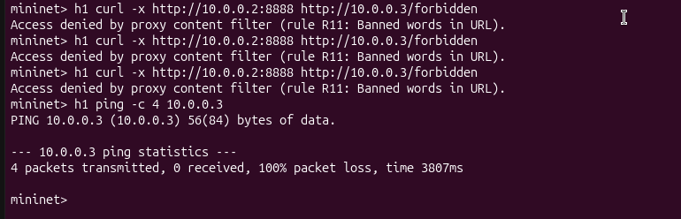

## 7.10 SDN REST API Status

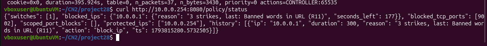

## 7.11 SDN Controller Startup

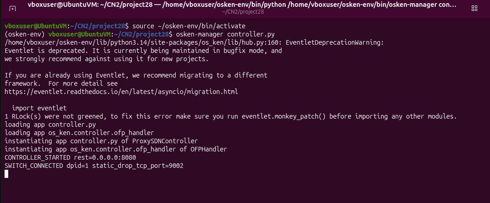

## 7.12 Controller Statistics

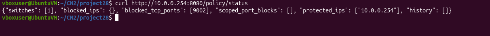

## 7.13 Dashboard


## 7.14 Testing Results

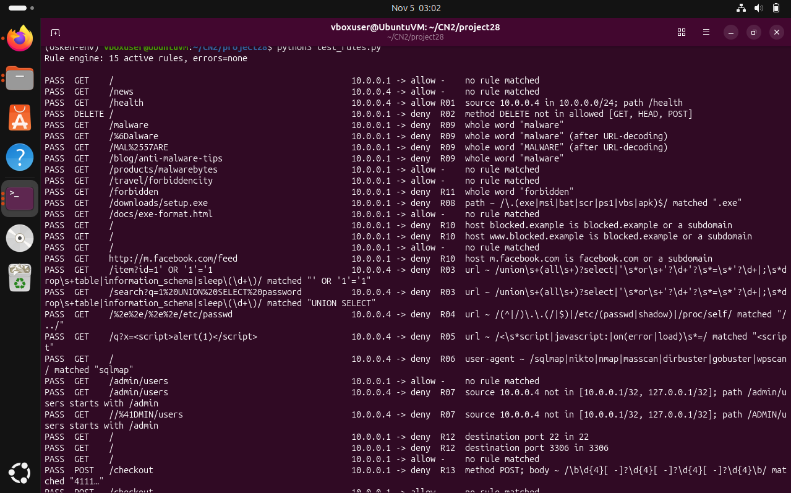


---

# 8. Testing and Evaluation

The system is evaluated using automated tests, traffic generation, and performance experiments.

### Functional Testing

- Valid HTTP request forwarding.
- Content filtering.
- Policy decision verification.
- Dynamic IP blocking.
- Port blocking.
- Unblocking.
- REST API functionality.

### Network Testing

- Mininet connectivity.
- OpenFlow switch connection.
- Flow rule installation.
- Packet drop verification.
- Controller statistics.

### Performance Testing

- Direct backend response time.
- Proxy response time.
- Proxy overhead.
- Traffic workload testing.
- Attack scenario testing.

---

# 9. Team Contribution Summary

| Member | Area | Files |
|---|---|---|
| Prajwal M R | Application Layer | `proxy.py`, `client.py`, `service.py` |
| Moola Adithya | Network Layer and SDN Integration | `topology.py`, `controller.py`, `rules.py`, `policy.json`, `lab.py` |
| Nishanth U | Testing, Performance, and Dashboard | `test_proxy_http.py`, `test_rules.py`, `run_tests.py`, `bench.py`, `traffic.py`, `run_experiments.py`, `harness.py`, `dashboard.py`, `ui/index.html`, `README.md`, `POLISH_NOTES.md` |

---

# 10. Conclusion

The Proxy and Content Filtering System demonstrates how application-layer filtering can be integrated with SDN-based network enforcement.

The TCP proxy inspects HTTP requests and evaluates configurable security policies. The OS-Ken controller dynamically installs OpenFlow rules in the Open vSwitch to block unwanted traffic.

The Mininet environment provides a controlled network for testing, while the testing and performance evaluation components measure the functionality and overhead of the system.

The project demonstrates:

- TCP proxy development.
- Application-layer content filtering.
- Mininet network emulation.
- SDN controller implementation.
- OpenFlow-based traffic enforcement.
- REST API integration.
- Dynamic security policy management.
- Automated testing and performance evaluation.

## GitHub Repository

https://github.com/MoolaAdithya/proxy-content-filtering-system
